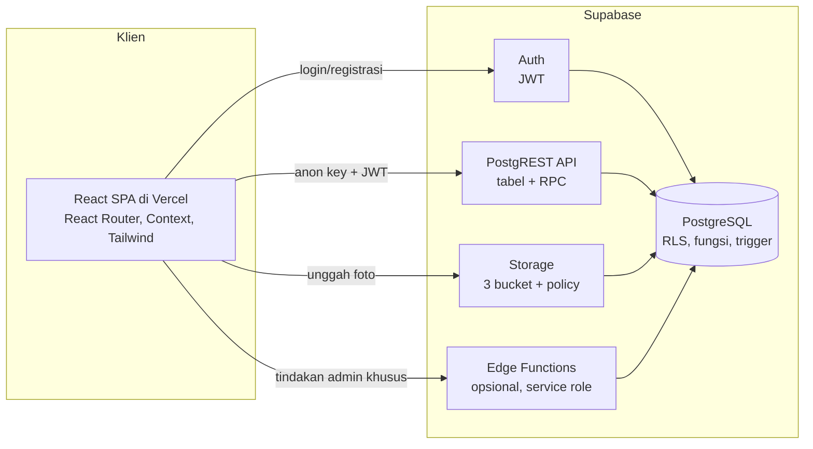
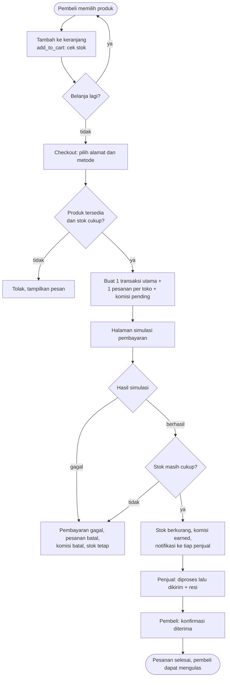
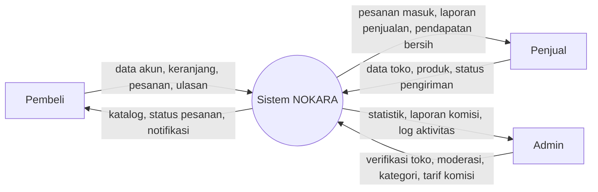
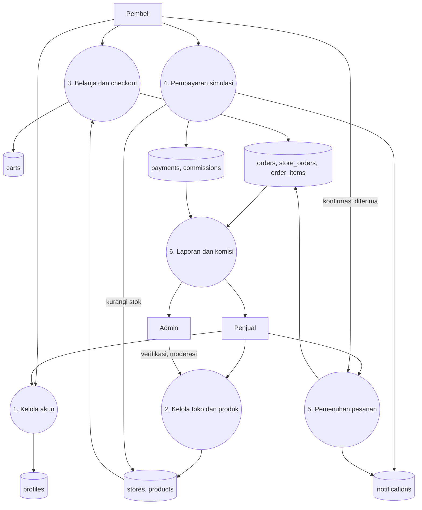

# Arsitektur dan analisis sistem NOKARA

Bahan untuk bagian "backend dan diagram sistem" pada presentasi PBL. Analisis bisnis, Business Model Canvas, dan strategi digital marketing tidak termasuk di sini dan perlu disusun kelompok.

## Arsitektur aplikasi

Tidak ada server backend buatan sendiri. Aturan bisnis yang sensitif (harga, stok, pembayaran, komisi, role) berada di fungsi PostgreSQL, sehingga tidak dapat dilewati dengan memodifikasi kode frontend.

## Flowchart belanja multi-vendor

## DFD level 0 (diagram konteks)

## DFD level 1

## Kebutuhan fungsional (ringkas)

| Kode | Kebutuhan | Letak di sistem |
|---|---|---|
| F1 | Registrasi, login, logout, hak akses per role | `AuthContext`, `routes/guards.jsx`, trigger `handle_new_user` |
| F2 | Katalog, pencarian, kategori, detail produk | `pages/public`, fungsi `search_products` |
| F3 | Keranjang dan total otomatis | `CartContext`, `add_to_cart` |
| F4 | Checkout multi-vendor | `pages/buyer/Checkout.jsx`, fungsi `checkout` |
| F5 | Simulasi pembayaran dan konfirmasi pesanan | `pages/buyer/Payment.jsx`, fungsi `simulate_payment` |
| F6 | Pengelolaan stok | Form produk penjual; pengurangan otomatis saat pembayaran |
| F7 | Pengelolaan status pesanan | Fungsi `update_store_order_status` |
| F8 | Verifikasi toko dan moderasi | `pages/admin/Stores.jsx`, `Products.jsx` |
| F9 | Komisi dan laporan | `commissions`, fungsi `sales_report` |
| F10 | Notifikasi | Tabel `notifications`, ditulis fungsi database |

## Kebutuhan nonfungsional (ringkas)

| Aspek | Penerapan |
|---|---|
| Keamanan | RLS semua tabel, hak kolom minimum, fungsi dengan validasi role, tanpa secret di frontend |
| Integritas data | Foreign key, CHECK constraint, transaksi database, penguncian baris saat checkout dan pembayaran |
| Responsif | Tailwind, navigasi seluler, tabel dapat digulir mendatar |
| Kemudahan pengembangan | Lapisan `services` terpisah dari halaman, migrasi SQL bernomor, uji otomatis |
| Aksesibilitas | Label formulir, fokus keyboard terlihat, `prefers-reduced-motion` dihormati |
